# One weekend, eight databases

*How Claude built the same analytical database eight times, in parallel,
without going over the subscription. And what that means for building business
software.*

---

## The short version

| | |
|---|---|
| **What was built** | A complete analytical SQL database (SQL, storage format, HTTP server, parallel execution), built independently **six times**: Java, Clojure, Rust, Python, Go and Common Lisp. Then **twice more in assembly language** (x86-64 and ARM), plus hand-tuned assembly "kernels" for both chips. |
| **How much code** | About **193,000 lines**, written by AI agents. |
| **Correctness** | Every engine passes **100 %** of its conformance suite: 746 test cases, a share of them hidden from the agents. |
| **Wall-clock time** | Kick-off Saturday 13:46 → all six main engines through all five phases by **Saturday 23:21 (under 10 hours)** → everything, assembly included, done Monday morning. |
| **Agent time** | **75 hours** of AI agent work in **108 recorded sessions**. Up to **12 sessions ran at once**. |
| **Cost** | **$1,256 at API list prices.** It actually ran on a Claude subscription: **no overage, no rate-limit rejection, ever.** |
| **People** | One owner giving direction. **Two** hands-on interventions in the whole project, both logged. |

---

## The challenge

Most "AI wrote my app" stories are one model building one thing once. We
wanted something harder to fake. We wrote a specification for an analytical
database, then asked Claude to build it **from scratch, independently, in
eight languages**, and measured everything along the way:

* development time, tokens and cost;
* correctness against a shared, language-neutral test suite (some of it hidden);
* performance, memory and code quality.

The database is not a toy. It has a SQL dialect with joins, grouping,
subqueries and aggregation, a binary column storage format, an HTTP
server with concurrency control, timeouts and cancellation, and parallel and
vectorized execution. It was built in five phases.

## The cast

* **The conductor.** One Claude Code session (the "orchestrator") wrote the
  spec and the test harness. It ran the experiment: it started agent waves,
  reviewed results, merged accepted work and wrote the reports. It never
  wrote engine code itself; that rule was enforced and audited.
* **The orchestra.** Fresh Claude agent sessions, one per language, phase and
  attempt. Each worked in its own **sandbox**:
  * its own copy of the spec and the public tests, and nothing else;
  * no internet, no other language's code, no hidden tests;
  * no access to the owner's home directory.
* **The ARM box.** A machine called *spark* (an NVIDIA GB10) for native ARM
  work. The ARM assembly agents ran there, in the same kind of sandbox.
* **The referee.** An automated validator. It rebuilt every submission from a
  clean copy and ran the public **and hidden** tests, so an agent could not
  grade its own homework.

*Up to 16 sessions were active in one 10-minute slot (12 at any single instant).
The quiet stretches are review-and-merge time between waves. The long one on
Sunday night is the project waiting for its next go-ahead, not anything
stuck.*

## The timeline

**Saturday: the big build.**

| time (US Eastern) | milestone |
|---|---|
| 13:46 | First commit: specification, test harness, orchestrator. |
| 15:22 | Assembly kernels pass natively on both x86-64 and ARM. |
| 16:15 | All six engines pass Phase 1 (protocol, catalog, CSV/JSON loading), hidden tests included. |
| 17:09 | Phase 2, the full SQL dialect. |
| 18:49 | Phase 3: storage format. Every engine reads every other engine's files (a 6 × 6 interoperability matrix). |
| 20:45 | Phase 4: HTTP server and concurrency. |
| 23:21 | Phase 5: parallel and vectorized execution, plus the first benchmark. **All twenty benchmark queries give identical answers in all six engines.** |

**Sunday: changing the engines after they were built.** Real software changes
after it ships, so the agents also got the tasks that come after version 1:

* add `UNION ALL`;
* widen decimals to 38 digits, including a new storage-format version;
* restructure the planner without changing behaviour;
* find a planted bug from a symptom-only bug report;
* make it faster;
* call native assembly kernels.

Meanwhile the two assembly-language engines started, as a separate stretch
goal with its own budget cap.

**Monday: assembly finishes, then the grown-up checks.**

* The assembly engines completed every task the others did.
* Each engine got two independent AI code reviews.
* Benchmarks ran on both chips.
* Black-box robustness probes checked what the reviewers suspected.

## What it cost

| group | sessions | agent hours | list-price cost |
|---|---|---|---|
| Six main engines (all phases and later tasks) | 78 | 58.6 | $855 |
| Assembly kernels (both chips) | 10 | 5.0 | $90 |
| Assembly engines (both chips) | 20 | 11.9 | $310 (cap: $600) |
| **Total** | **108** | **75.4** | **$1,256** |

A complete, tested database engine, including five rounds of later changes,
came to about **$120–180 per language** at list price. Even the
"let's write a database in assembly, why not" stretch goal came in at about
half its cap.

The costs above are for the agent sessions only. The orchestrating session's
own usage is not included.

## Staying inside the subscription

The $1,256 is what these sessions *would* have cost on the pay-per-token API.
They actually ran on a **Claude subscription**, which has two rolling limits:
a 5-hour window and a 7-day window. Twelve agents working at once can burn
through a 5-hour window quickly. Our first wave of 8 agents used about 22 % of
it in 35 minutes. So the orchestrator had guard rails:

1. **A usage gate.** No new agent starts while the 5-hour or 7-day window is
   above **80 %**. A queued run simply waits, re-checking every 5 minutes,
   until the window rolls forward. (The threshold started at 60 %; the owner
   raised it to 80 %.)
2. **A watchdog.** A running agent is stopped at **95 %** of the 5-hour
   window, or **immediately** if it ever starts using paid overage.
3. **A fresh, short-lived credential per run.** It is never shared, and it is
   deleted from the ARM box after each run.

How it played out:

* **The gate did its job on Saturday afternoon** (the shaded bands in the
  timeline). During the busiest stretch six runs queued at the gate and waited
  **35–95 minutes** for the 5-hour window to roll forward, then started.
  Nobody had to babysit it.
* **The 5-hour window peaked at 89 %. The 7-day window peaked at 62 %.**
* **All 108 sessions saw only "allowed" rate-limit status: no rejections, no
  overage, no surprise bill.**

In short: we let the work slow down rather than let the bill go up.

## What came out

**Correctness: 100 % everywhere.** All eight engines pass their full
conformance suite.

**Speed: a wide spread, and that's the point of the experiment.** On a
1-million-row workload (geometric mean over 20 queries):

* Go and Rust are fastest at about 2 ms. The assembly engines are right
  behind, and the ARM one runs on different hardware, so it isn't directly
  comparable.
* Java is at 3.4 ms. Clojure and Common Lisp are at 5–7 ms.
* Python, gamely interpreting its way through, is at 25 ms.

**Size.**

* Clojure says it in 12,000 lines. Go needs 25,000.
* The assembly engines need about 35,000 lines each. Nobody was surprised.

## Keeping the AI honest

Fast is nice. Trustworthy matters more. The safeguards:

* **Hidden tests.** Part of every acceptance suite was withheld, so passing
  meant actually implementing the spec, not memorising the tests.
* **Clean-room rebuilds.** Every submission was rebuilt from scratch in a
  sandbox before it counted.
* **Two independent AI code reviewers per engine.** They agreed on 88–92 % of
  scores exactly.
* **Black-box probes for what the reviewers suspected.** These found real
  defects, which we report rather than hide:
  * very long `OR` conditions crash both assembly engines;
  * three engines (Go, Java, Clojure) don't honour a query timeout while
    chewing on a gigantic statement;
  * one assembly engine has a memory-limit leak.

  The same probes **cleared** several suspected problems.
* **Everything recorded.** Every session's transcript, cost and outcome is
  kept, including the 7 that failed or timed out. A dashboard of all of it is
  published at <https://pgdad.github.io/poly-query/>.

## Beyond databases: the same recipe for business services

Nothing here is specific to databases. The recipe carries over to business
functionality such as a pricing engine, a billing service, a claims rule
engine or a regulatory report:

1. **Write the specification first, in plain language.** Inputs, outputs,
   errors, edge cases. This is where the people who know the business spend
   their time.
2. **Turn it into a language-neutral test suite**, and keep part of it hidden
   from the builders.
3. **Let agents build in parallel**, each in a sandbox, each one a fresh
   session with a clear task.
4. **Validate automatically** with a clean rebuild and the hidden tests.
   Nothing merges on an agent's word.
5. **Put guard rails on spend**: usage gates, budget caps per task, and a
   watchdog.
6. **Keep going after version 1.** Change requests, refactors and bug hunts
   are ordinary tasks too, and here they took minutes to a couple of hours each.

The expensive part of software has always been knowing *what* to build. This
approach puts people on that, and lets the agents grind through the *how*,
around the clock.

## Two implementations that check each other

Here's the idea we find most exciting for business use. When writing code is
cheap, **write critical logic twice**, in two different languages, by two
independent agents, from the same spec. Then run both on the same inputs and
**compare the answers.**

* If both agree, confidence goes up a lot, because independent builds rarely
  make the *same* mistake.
* If they disagree, one of them has a bug, or the **spec is ambiguous**.
  Either way you found it before a customer did.

This isn't hypothetical; it happened here:

* **Agreement as evidence.** Six independently written engines returned
  identical results on all 20 benchmark queries. Each also read the storage
  files written by every other engine.
* **Disagreement found spec gaps.**
  * Two agents independently flagged that comparing very large integers with
    decimals overflowed under the spec's own rule. That became a spec fix
    (question SPEC-Q-001).
  * When the engines disagreed on what to do with a gigantic SQL expression
    (some computed it, some refused, some hung), that divergence became a new
    rule, change request CR-6.

Two practical notes:

* **Keep a third opinion for the reference answers.** We never used one
  engine's output as the expected result for another. Expected results came
  from the spec, cross-checked against an independent database (SQLite).
  Two implementations that share a misunderstanding of the spec will agree
  wrongly; only a clear spec and some independent checks catch that.
* **Where to use it:** anywhere a wrong number is expensive, such as pricing,
  billing, interest and fees, tax, risk limits or eligibility rules. For about
  twice the build cost, still small in agent dollars, you get a running
  cross-check on every input, in testing and even in production shadow mode.

## What didn't go perfectly (because it never does)

* Go's "make it faster" task ran out of time twice. Its unmerged work is
  1.74× faster but is parked for a decision.
* The ARM assembly engine's optimization made it 1.82× faster overall, but one
  query got 8× *slower*. Benchmarks keep everyone honest.
* One agent finished its work and then just… didn't exit. The orchestrator
  noticed, stopped it and logged the intervention.
* The robustness defects above are real and open. Fixing them is the next
  task: a new round of agent runs to meet CR-6.

## Where to look

* Live results dashboard: <https://pgdad.github.io/poly-query/>
* Source code and all raw data: <https://github.com/pgdad/poly-query>
* Detailed results narrative: `docs/results/README.md`
* Per-session records (manifest, telemetry, transcript): `experiments/runs/`

*Charts are regenerated from the experiment data by
`tools/reporting/story_assets.py`.*
