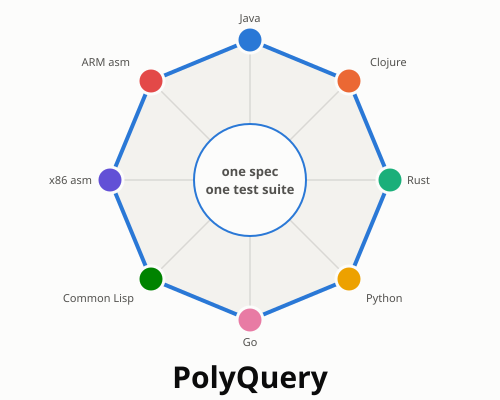
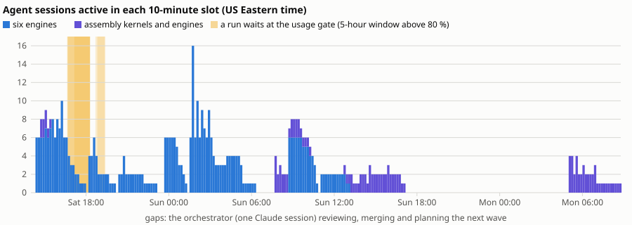

# PolyQuery

**An AI just wrote a SQL database in assembly language, and it outruns Java.**
Same benchmark, same machine: 2.85 ms for the AI-written x86-64 assembly
engine, 3.41 ms for Java, at half the memory. That is the surprise. The real
story is how it got there, and why we can trust the answer.

> **One spec. Eight languages. One answer.**

*A VSNC story: **V**ision, **S**teps, **N**ews, **C**ontributions.*

| | The five things to remember |
|---|---|
| **Symbol** | **The polygon.** Eight corners are eight independently built database engines. The middle is the one specification and test suite they all answer to. The name says the same thing: *Poly*-gon, *Poly*-glot, *PolyQuery*. |
| **Slogan** | **One spec. Eight languages. One answer.** |
| **Surprise** | **An AI wrote a complete SQL database in raw assembly language, and it beat Java.** On the same 1-million-row benchmark, on the same machine, the x86-64 assembly engine answers in 2.85 ms against Java's 3.41 ms, using half the memory. Both assembly engines together cost $310. |
| **Salient point** | **It started with a spec, not with code.** Language-agnostic tests checked every implementation against the same expected answers, so eight engines could be verified against each other. |
| **Story** | **How it was made:** one weekend, one conductor, up to twelve AI agents at a time, a subscription that never went into overage. Read on. |

---

## V — Vision

Software is expensive because of two hard questions: *what exactly should it
do?* and *how do we know it does that?* Typing the code was never the hard
part. Now it is nearly free.

PolyQuery tests a simple vision:

1. **People write the specification**: inputs, outputs, errors and edge cases,
   in plain language.
2. **People turn it into language-agnostic tests**: questions with known
   answers that any implementation must give.
3. **AI agents build the implementations**, in parallel, in sandboxes, as many
   times and in as many languages as we like.
4. **The tests, and the implementations themselves, check the result.** If
   independent builds agree, trust goes up. If they disagree, we've found a bug,
   or a gap in the spec, before a customer did.

The test bed was deliberately hard: a complete analytical SQL database. It
includes SQL with joins, grouping and subqueries, a binary storage format, an
HTTP server with concurrency, timeouts and cancellation, and parallel,
vectorized execution. It was built **eight times**: in Java, Clojure, Rust,
Python, Go and Common Lisp, then in x86-64 and ARM assembly.

## S — Steps (the story of how it was made)

**Step 1: write the spec (Saturday 13:46).** A Claude Code session, "the
conductor", wrote the specification first. It covered:

* the data types and SQL dialect;
* the wire protocol and the storage file format;
* the concurrency rules and the error codes.

It also defined five build phases, from an in-memory engine (Phase 1) to
parallel execution (Phase 5).

**Step 2: write the tests, in no particular language.** 746 test cases in a
plain-text format. Each one is a request and its expected answer, so any
engine can be checked without anyone reading its code. Part of the suite was
**kept hidden** from the builders, so passing meant implementing the spec,
not memorising the tests. Expected answers came from the spec and were
cross-checked against SQLite, never taken from another engine.

**Step 3: build in parallel.**

* The conductor started fresh agent sessions, one per language and phase.
* Each agent worked alone in a **sandbox**:
  * the spec and the public tests, and nothing else;
  * no internet, and no peeking at the other languages.
* The ARM assembly agents ran natively on a separate ARM machine.

**Step 4: referee every result.** Nothing merged on an agent's say-so. Every
submission was rebuilt from a clean copy and run against the public **and
hidden** tests.

* **Saturday 16:15:** all six engines pass Phase 1.
* **Saturday 23:21:** all six pass Phase 5, under ten hours after the first
  commit.

**Step 5: stay inside the subscription.**

* No new agent starts while the 5-hour usage window is above 80 %. Instead the
  run waits for the window to roll forward. On Saturday six runs waited 35–95
  minutes this way.
* A watchdog stops a running agent at 95 %, or instantly on any paid overage.
* Usage peaked at 89 % of the 5-hour window and 62 % of the weekly window.
  All 108 sessions saw "allowed": no rejections, no overage.

**Step 6: change it, like real software.** On Sunday the agents got the jobs
that come after version 1:

* add a feature (`UNION ALL`);
* widen a data type, which also needed a new file format version;
* restructure the planner;
* hunt a planted bug from a vague report;
* make it faster;
* plug in hand-written assembly kernels.

**Step 7: go to extremes, then audit.**

* Two more engines were built in assembly language and finished every task
  the others did.
* Each engine got two independent AI code reviews.
* Black-box probes then tested what the reviewers suspected.

**The bill.** 108 agent sessions and 75 agent-hours. That is **\$1,256 at API
list prices**, run on a Claude subscription. A complete, tested engine with
all its later changes came to about **\$120–180 per language**.

## N — News

### Six strangers, one answer

Six AI agents never saw each other's work. Each built a complete database
engine, in Java, Clojure, Rust, Python, Go and Common Lisp, from the same
specification. Given the same 20 benchmark queries over a million rows, **all
six return identical answers, every time.** Each engine also reads the storage
files written by every other engine: 36 out of 36 combinations work. The two
assembly-language engines that followed pass the same conformance
suite.

That is the salient point made concrete. When independent builds agree on
everything a shared, language-agnostic test suite can ask, agreement becomes
evidence.

**Also in the news:**

* **Disagreement is useful too.** Where the engines *did* differ, the
  specification had a gap.
  * Two agents independently flagged that comparing huge integers with
    decimals overflowed under the spec's own rule. The spec was fixed.
  * The engines split on what to do with gigantic SQL expressions: some
    computed them, some refused, some hung. That became change request CR-6,
    and the agents implemented it in every engine.
* **The opening hook, in numbers.** The AI-written x86-64 assembly engine
  answers in 2.85 ms against Java's 3.41 ms, at 1,612 MiB peak memory against
  3,219 MiB. Both assembly engines together cost \$310.
* **Eight engines in one weekend, for the price of a laptop.** Six engines
  went through all five phases in under 10 hours. Everything cost \$1,256 at
  API list prices.
* **75 hours of AI work, zero overage.** A usage gate paused work instead of
  raising the bill.
* **The AI auditors caught real bugs.** Independent AI code reviews flagged
  suspected defects; black-box probes confirmed some and cleared others.
  Everything is published, failures included.
* **Next: twin implementations for the numbers that matter.** The same recipe
  applies to pricing, billing or interest calculations, with two independent
  implementations checking each other on every input.

## C — Contributions

**What this project gives us:**

* **A method** that works beyond databases: spec first, language-agnostic
  tests (some hidden), parallel sandboxed agents, an automatic referee, and
  guard rails on spend.
* **Twin-implementation verification.** For logic where a wrong number is
  expensive, build it twice in different languages and compare every answer.
  * When both agree, confidence goes up a lot.
  * When they disagree, there's a bug or a spec gap, found early.
  * One caveat: keep an independent reference (the spec, or a trusted
    system), because two builds that share a misreading of the spec will agree
    wrongly.
* **Reusable tooling:**
  * the orchestrator (waves, sandboxes, usage gate, watchdog, validation);
  * the test harness;
  * the reporting dashboard.
* **Open evidence:** every one of the 108 agent sessions is recorded, with its
  transcript, cost, time and outcome, failures included. Live dashboard:
  <https://pgdad.github.io/poly-query/>. Code and data:
  <https://github.com/pgdad/poly-query>.

**Who contributed:**

* **The owner** set the direction and the budget, and made the calls: raising
  the usage gate to 80 %, approving the assembly stretch goal and its $600 cap,
  choosing the ARM machine.
* **The conductor** (one Claude Code session) wrote the spec, the tests and
  the tooling. It ran the waves, refereed, and wrote the reports, and it never
  touched engine code.
* **The agents** (108 Claude sessions) wrote about 193,000 lines across eight
  engines and the assembly kernels.
* **Two hands-on interventions** in the whole project, both logged.

---

*One spec. Eight languages. One answer.*

*Companion version: [the full story](README.md). Charts are generated from the
experiment data by `tools/reporting/story_assets.py`; `build.sh` rebuilds both
PDFs.*
